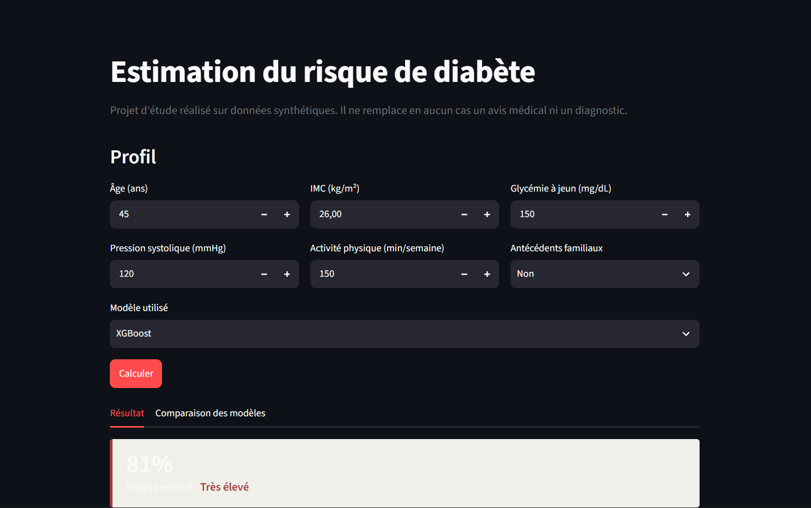
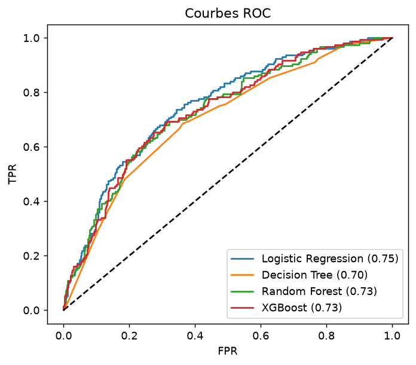
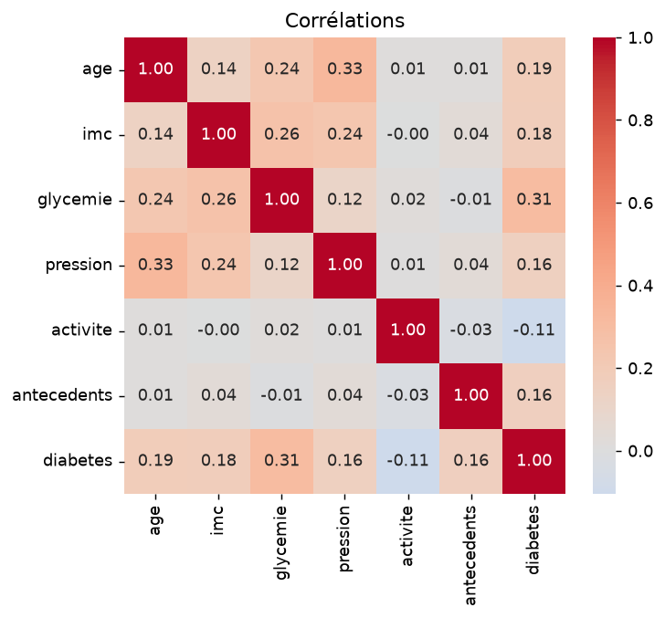
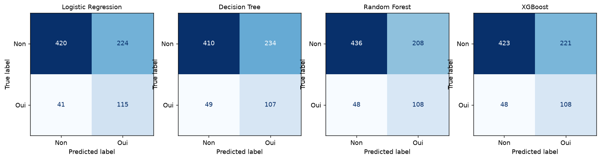

# AI Predictive Intelligence — Prédiction du risque de diabète


Application de Machine Learning qui estime la **probabilité de risque de diabète** à partir de 6 variables médicales, la classe en **4 niveaux de risque**, **explique chaque prédiction** (SHAP) et **compare 4 algorithmes**.

> **Projet pédagogique.** Ce n'est ni un dispositif médical ni un outil de diagnostic. Les modèles sont entraînés sur des **données synthétiques**.

<!-- Ajoute ici une capture d'écran de ton app :  -->

## Fonctionnalités

- Saisie interactive : âge, IMC, glycémie, pression artérielle, activité physique, antécédents familiaux
- Probabilité de risque + niveau (Faible / Modéré / Élevé / Très élevé)
- Explication locale de chaque prédiction avec **SHAP** (graphique waterfall)
- Comparaison de 4 modèles : Logistic Regression, Decision Tree, Random Forest, XGBoost
- Métriques : Accuracy, Precision, Recall, F1-score, ROC-AUC (+ validation croisée 5 plis), matrices de confusion
- Visualisations : courbes ROC, matrice de corrélations

## Stack technique

| Bibliothèque | Rôle |
|---|---|
| NumPy / Pandas | Génération et préparation des données |
| Matplotlib / Seaborn | Visualisations et corrélations |
| Scikit-learn | Modèles, pipelines, métriques, validation croisée |
| XGBoost | Gradient Boosting |
| SHAP | Explicabilité des prédictions |
| Streamlit | Interface utilisateur |

## Résultats (jeu de test, seuil 0,5)

| Modèle | Accuracy | Precision | Recall | F1 | ROC-AUC |
|---|---|---|---|---|---|
| Logistic Regression | 0,669 | 0,339 | 0,737 | 0,465 | 0,750 |
| Decision Tree | 0,646 | 0,314 | 0,686 | 0,431 | 0,700 |
| Random Forest | 0,728 | 0,375 | 0,596 | 0,460 | 0,733 |
| XGBoost | 0,665 | 0,329 | 0,692 | 0,446 | 0,732 |

*Valeurs indicatives : elles peuvent varier légèrement selon les versions des bibliothèques.*

<p align="center">
  
  
</p>
<p align="center"></p>

## Choix techniques et enseignements

- **Classes déséquilibrées (~20 % de positifs).** Sans correction, le Recall s'effondrait à ~5 % (les modèles prédisaient presque toujours « non »). J'ai utilisé `class_weight="balanced"` et `scale_pos_weight` pour XGBoost.
- **Choix des métriques.** En dépistage, un faux négatif coûte plus cher qu'un faux positif : le Recall et le ROC-AUC sont plus informatifs que l'Accuracy seule.
- **La régression logistique est compétitive.** Les données synthétiques sont générées par une relation logistique, ce qui avantage ce modèle. Sur des données réelles, les modèles d'arbres pourraient dominer.
- **Explicabilité.** SHAP montre quelles variables poussent le risque vers le haut ou le bas pour un patient donné (corrélations apprises, pas des causes).

## Installation et lancement

```bash
git clone https://github.com/<ton-pseudo>/diabetes_risk.git
cd diabetes_risk
python -m venv .venv
# Windows : .venv\Scripts\activate     |  macOS/Linux : source .venv/bin/activate
pip install -r requirements.txt

python train.py          # entraîne les modèles et génère outputs/
streamlit run app.py     # lance l'interface sur http://localhost:8501
```

Pour utiliser tes propres données : `python train.py mon_fichier.csv` avec les colonnes
`age, imc, glycemie, pression, activite, antecedents, diabetes` (0/1).

## Structure

```
diabetes_risk/
├── app.py              # Interface Streamlit
├── train.py            # Entraînement, évaluation, graphiques
├── src/data.py         # Génération des données, niveaux de risque
├── outputs/            # Métriques et graphiques générés
├── docs/               # Images pour le README
└── requirements.txt
```

## Limites

- Données synthétiques : les modèles retrouvent les règles du générateur, pas la réalité clinique.
- Seuils de risque (20 / 50 / 75 %) choisis à titre pédagogique, non validés médicalement.
- Probabilités non calibrées et pas d'optimisation d'hyperparamètres.

## Pistes d'amélioration

- Entraîner sur un vrai jeu de données anonymisé (Pima Indians, NHANES)
- Optimiser les hyperparamètres (`GridSearchCV` / Optuna) et calibrer les probabilités
- Ajuster le seuil de décision selon l'objectif (maximiser le Recall)
- Ajouter des tests unitaires, une CI GitHub Actions et un déploiement Streamlit Cloud

## Auteur

**Mohamed Lamine Thiaw** — M1 Intelligence Artificielle & Big Data
[LinkedIn](https://linkedin.com/in/mohamed-lamine-thiaw-9390bb442/) · [GitHub](https://github.com/lvminrr)
